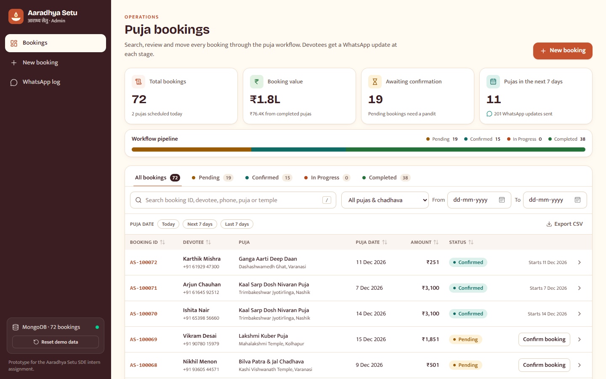
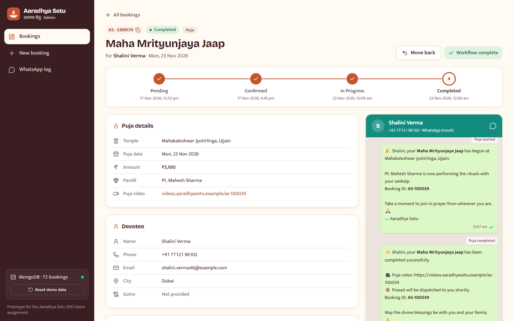
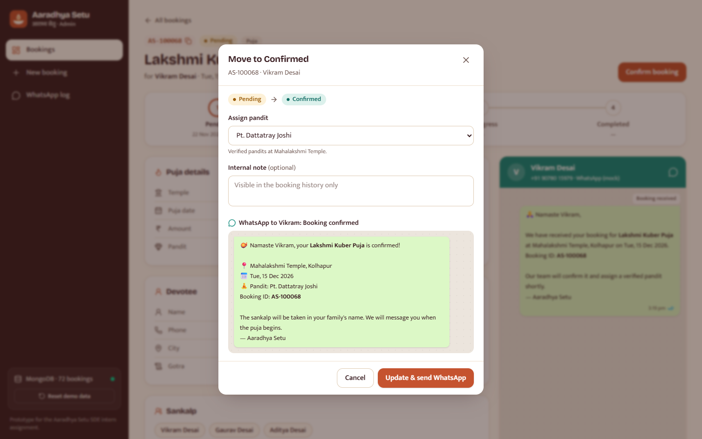
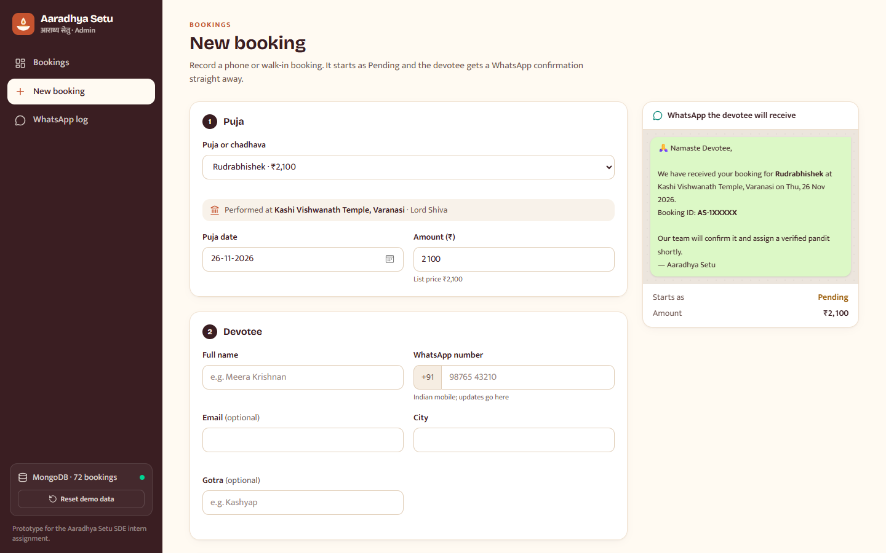
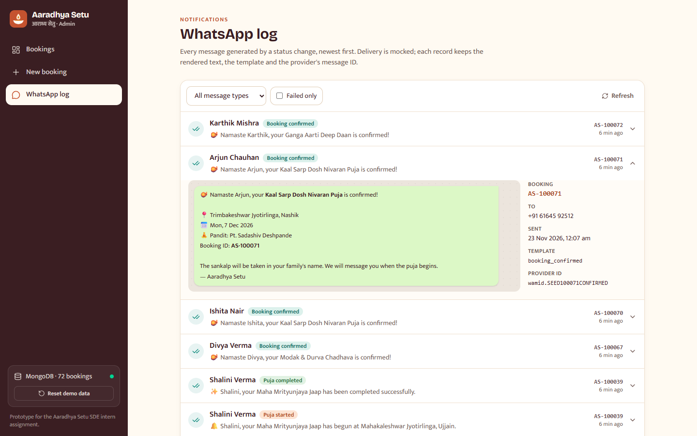
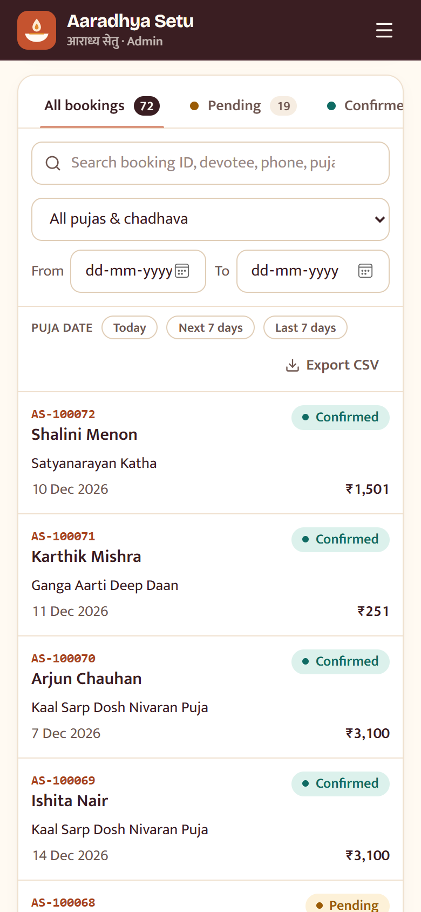
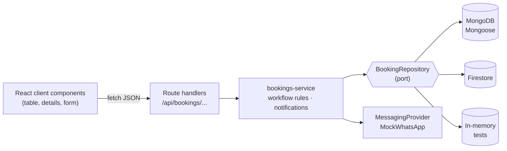

# Aaradhya Setu · Puja Booking Dashboard

An admin dashboard for running Aaradhya Setu's online puja bookings. Ops staff can find any booking in seconds, see everything about it, and move it through the workflow. Each step sends the devotee a templated WhatsApp update, which is mocked here.

**Assignment:** Option 2, _Full-Stack: Puja Booking Dashboard_ (Next.js, Node.js, MongoDB). I also added the core of Option 3: every status change renders a WhatsApp template with the devotee's name, puja and booking ID, and stores it in a notification history.



| Booking details                                         | Status change with message preview                   |
| ------------------------------------------------------- | ---------------------------------------------------- |
|  |  |
| **New booking**                                         | **WhatsApp log**                                     |
|         |    |

<p align="center"></p>

---

## Run it

```bash
npm install
npm run dev          # http://localhost:3000
```

No database setup is needed. Without `MONGODB_URI`, the dev server starts a real local `mongod` through `mongodb-memory-server`, keeps its data in `.data/mongo` so it survives restarts, and seeds **72 realistic bookings** on first run. The first start downloads the MongoDB binary, which takes about a minute.

| Script                            | What it does                                                     |
| --------------------------------- | ---------------------------------------------------------------- |
| `npm run dev` / `build` / `start` | Next.js dev server, production build, production server          |
| `npm test`                        | 78 tests (Vitest). The contract suite runs against a real mongod |
| `npm run seed`                    | Reset whichever database is configured to the demo data          |
| `npm run lint` / `typecheck`      | ESLint, TypeScript                                               |

To use MongoDB Atlas or Firestore instead, copy [`.env.example`](.env.example) to `.env.local` and fill in `MONGODB_URI` or the Firebase service-account variables. The **Reset demo data** button in the sidebar restores the dataset at any time.

**Demo tips**

- Bookings dated **today** can be taken through the whole workflow.
- Press <kbd>/</kbd> to jump to search. Every filter is kept in the URL, so you can share a filtered view.
- Phone numbers ending in **0000** simulate an undeliverable WhatsApp number. You'll see the failed state and the **Retry** button.

---

## What it does

| Requirement                                                | Where                                                                                                                                  |
| ---------------------------------------------------------- | -------------------------------------------------------------------------------------------------------------------------------------- |
| Booking ID, devotee, puja, date, amount, status table      | Dashboard table, with a card layout on mobile                                                                                          |
| Searchable                                                 | One search box matches booking ID, devotee name, **phone (any spacing)**, puja, temple or city. It is debounced and runs on the server |
| Filters / sorting                                          | Status tabs **with live counts**, puja filter, date range plus _Today / Next 7 days / Last 7 days_, sortable columns, pagination       |
| Booking details view                                       | `/bookings/:id`: stepper with timestamps, puja / devotee / sankalp cards, activity timeline, WhatsApp thread                           |
| Status changes: Pending, Confirmed, In Progress, Completed | One-click advance from the table (optimistic, rolls back on error) or a dialog on the details page. Moving back requires a reason      |
| Backend APIs with persistence                              | REST route handlers → service layer → MongoDB (Mongoose). A Firestore adapter is included                                              |
| Responsive interface                                       | Sidebar on desktop, drawer and cards on mobile; tested at 390 px and 1440 px                                                           |
| _Option 3 extras_                                          | Templated WhatsApp messages (mock provider), notification history in the DB, resend, global log                                        |

Also included: KPI cards and a workflow pipeline bar, a new booking form with a live message preview, CSV export of the current filter, and skeleton, empty and error states throughout.

---

## Architecture



```
src/
  app/                 pages + REST route handlers (app/api/**/route.ts)
  components/          UI: bookings table, details, status dialog, WhatsApp thread, form
  lib/domain/          shared by server and client: types, workflow rules, templates, Zod schemas, query logic
  server/
    bookings-service.ts  business rules (transitions, pandit assignment, notify)
    repository.ts        storage port + ConflictError
    adapters/            mongo.ts · firestore.ts · memory.ts
    whatsapp.ts          messaging port + mock provider
    seed-data.ts         deterministic demo data, relative to today
tests/                 domain · service · repository contract · API
```

### API

All errors share one shape: `{ "error": { "code", "message", "details?" } }`.

| Method & path                              | Purpose                                                                                                   |
| ------------------------------------------ | --------------------------------------------------------------------------------------------------------- |
| `GET /api/bookings`                        | `q, status, puja, from, to, sort, order, page, pageSize` → `{ items, total, totalPages, counts }`         |
| `POST /api/bookings`                       | Create (starts `Pending`, sends "booking received") → `201` + `Location`                                  |
| `GET /api/bookings/:id`                    | Booking + its WhatsApp messages                                                                           |
| `PATCH /api/bookings/:id/status`           | `{ status, expectedStatus, note?, pandit?, videoUrl? }` → `200`, or `409` stale, `422` invalid transition |
| `GET/POST /api/bookings/:id/notifications` | Message history / resend the current stage's message                                                      |
| `GET /api/bookings/export`                 | CSV of everything matching the same filters                                                               |
| `GET /api/stats`                           | KPI numbers                                                                                               |
| `GET /api/notifications`                   | Latest messages across bookings                                                                           |
| `GET /api/health`, `POST /api/demo/reset`  | Driver + row count; restore demo data                                                                     |

```bash
curl -X PATCH localhost:3000/api/bookings/AS-100042/status \
  -H 'content-type: application/json' \
  -d '{"status":"Confirmed","expectedStatus":"Pending"}'
```

---

## Decisions worth explaining

- **The workflow is a state machine.** Bookings move one step at a time, so a devotee always gets the four messages in order. An admin can move one step back to fix a mistake, but only with a note. Rollbacks are recorded in the history and **never** message the devotee.
- **A puja can't start before its date.** Moving to _In Progress_ is refused until the puja date (in IST). The UI shows "Starts 12 Dec" instead of a button.
- **Concurrent edits are safe.** A status change includes `expectedStatus`. The update is a compare-and-set (`findOneAndUpdate({ bookingId, status: expected })` in Mongo, a transaction in Firestore). If two admins click at once, one wins and the other gets `409` with the current booking. A test races two updates to prove it.
- **Booking IDs come from an atomic counter.** `AS-100001`, `AS-100002`, … are allocated with `$inc` on a counter document, so concurrent creates never collide. This is tested too. The IDs are short enough to read out on a phone call.
- **Puja dates are calendar dates.** They're stored as `"YYYY-MM-DD"` strings, not timestamps. A puja happens on a day in India, so this avoids a UTC conversion shifting it to the day before. "Today" is computed in IST.
- **Storage sits behind a port.** The service only knows `BookingRepository`. MongoDB is the default, as the brief asks. The Firestore adapter shows the app isn't tied to one database. The same contract suite runs against the in-memory reference and a real mongod, and checks that search, sorting, pagination, counts, KPIs and export match exactly.
- **Mongo design:** indexes back the default views (newest first, by status, by puja date), and one aggregation produces the status-tab counts. Two denormalised keys (`statusRank` and a lower-cased name) let "sort by status" follow the workflow and "sort by devotee" ignore case.
- **Firestore trade-off:** Firestore has no substring search and needs a composite index for every filter and sort combination. For an internal dashboard with thousands of rows, the adapter reads the collection and applies the shared, tested query logic. Past that scale, search should move to a search index.
- **Messaging is behind a port.** `MockWhatsAppProvider` stands in for Meta's Cloud API or Gupshup. Every attempt is stored, failures included, so a delivery problem never blocks the status change. Templates use `{{name}}` placeholders that map directly to WhatsApp Business templates, and a missing value falls back to readable text instead of showing `{{videoUrl}}`.
- **One validation source.** The same Zod schemas validate API input and give the form instant feedback. Phone numbers in any common format are normalised to E.164.
- **Small details:** filters live in the URL, the CSV export guards against formula injection without mangling `+91…` numbers, and the Next.js 16 Cache Components boundaries are set up so the static shell prerenders and data streams in.

## Tests

```
tests/domain.test.ts               workflow rules, templates, validation, INR/IST formatting, CSV
tests/service.test.ts              full workflow → 4 messages in order, rollback is silent, failed delivery + resend
tests/repository.contract.test.ts  memory vs real MongoDB: 13 list queries, KPIs, export, ID race, status race
tests/api.test.ts                  route handlers: 200/201/400/404/409/422 and the error contract
```

CI (GitHub Actions) runs Prettier, ESLint, type-check, tests and a production build on every push.

## With more time

- Sign-in and roles (ops vs. pandit coordinators), with the real admin name recorded in the history
- Real WhatsApp Cloud API with approved templates, plus delivery receipts by webhook
- An outbox, so a status change and its notification are written atomically and retried in the background
- Cursor pagination and a search index for large datasets
- Ingesting new bookings from the Shopify storefront through an order webhook
